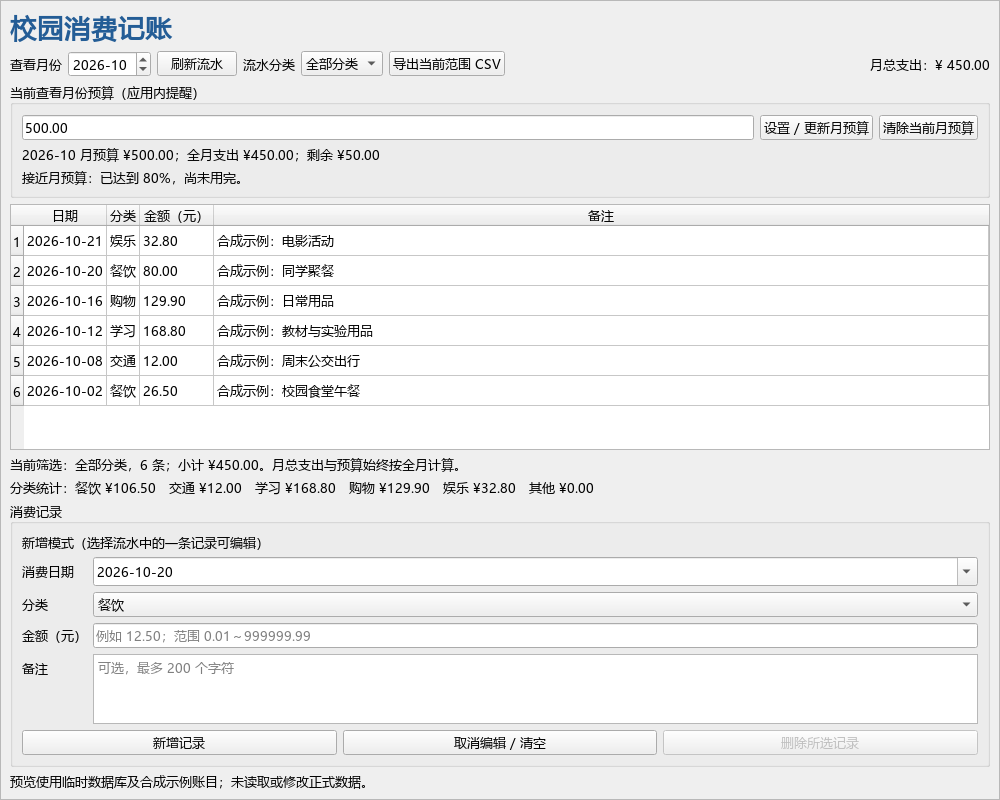

# 用 AI 迭代开发一个校园消费记账桌面程序

> 博客提交草稿，基于实际代码、Git 快照和测试记录整理。开发指令由主控代拟并委派给子 Agent，未冒充学生逐轮亲自输入；文末心得是可改写参考，发布前应结合自己的操作与感受确认。

## 需求与实现

这次选择了“个人校园消费记账 GUI”：记录生活消费、查看月份和分类统计，并根据预算给出提醒。程序使用 Python + PyQt6，SQLite 保存本地数据。金额按整数分存储，避免把 0.1+0.2 这类浮点误差带入账本。

最终支持消费记录新增/编辑/确认删除、月份查询、分类统计、按月预算、额度提醒、分类筛选及 CSV 导出。提醒显示在应用内；它没有后台通知、云同步或多账户功能。

## 实际迭代过程

| 轮次 | 主控提出的具体要求 | AI 实际修改 | 实际验证 |
| --- | --- | --- | --- |
| 第1轮：初版 | 先完成中文流水 CRUD、月统计与 SQLite 持久化，金额严格校验 | 分离模型、服务、存储与界面，实现可运行初版 | 初版定向回归 4 失败，真实暴露两个界面状态问题 |
| 第2轮：修复 | 取消选择须清空旧表单；写入完成但刷新失败须保留组合结果 | 重置表单并避免信号递归；refresh 返回成功状态，避免误报 | 4 条回归全通过；完整 96/96 通过 |
| 第3轮：预算 | 各月独立预算，精确区分 80%、100%、超支，清除预算不删流水 | 独立预算表、阈值计算、设置/清除及即时提醒 | 144/144 通过；另如实纠正一处测试预期算错 |
| 第4轮：筛选与导出 | 导出当前月份/分类，预算仍按全月计算，防公式与误覆盖 | 筛选小计、中文 CSV、格式转义、数据库目标保护和失败处理 | 最终 177/177 通过，无失败、错误或跳过 |

完整实际提示词、逐轮改动与代码快照见 [迭代记录](iteration_log.md)，不是事后虚构的聊天。原始提示词另存于 [第1轮](prompts/round1.txt)、[第2轮](prompts/round2.txt)、[第3轮](prompts/round3.txt)、[第4轮](prompts/round4.txt)。

## 检查与验证说明

验证并非只看“窗口能打开”。测试使用临时 SQLite 文件检查写入、修改、删除及重新连接后的数据；用 12.30+2.00+0.10+0.20=14.60 元核对月统计，同时检查 0.10+0.20 精确等于 0.30 元。无效金额、闰日、跨年月、空月份和不存在的记录都有对应边界用例。

预算按整数分比较，核对 80% 前后、刚好用完和超支。筛选后仍检查全月预算不会变化。CSV 用中文和包含逗号、引号、换行及公式前缀的备注验证，并检查数据库及已有导出文件不会被错误路径或失败写入损坏。

界面自动化实际创建 Qt 窗口并操作控件，包括删除取消、编辑与切月、数据库错误后的状态恢复。初版的失败日志和后续通过日志均保留；最终报告为 [完整测试报告](../reports/test_report.md)，逐条执行记录见 [测试日志](../reports/pytest_output.txt)。

这张图由临时合成账目渲染。首次 offscreen 渲染因字体未正确加载出现文字方框，图像检查发现后，预览脚本显式加载微软雅黑字体，重做并复核可读性。这也说明功能测试通过后仍应查看实际输出。没有把截图当成已完成原生 Windows 人工操作、不同 DPI 或大规模数据验收。亲自演示可按照 [验收步骤](demo_checklist.md) 进行。

## 心得参考：测试也需要验证

这次协作中值得反思的一点是：AI 写出的测试期望也可能出错。第三轮测试一度把 79.99/99.99 当成达到 80%，但独立算术核对后发现实际约为 79.9979998%，仍低于 80%。正确处理是修正测试预期并保留记录，而不是为了让测试变绿去改正确的业务逻辑。

另一点是，功能“写入成功”不等于整个界面流程都正确。最初写入后读取失败会被成功提示覆盖，虽然账目已经保存，用户却可能误以为没保存而再次提交。把“写入”和“刷新”分开描述，再用可复现的回归用例验证，比笼统要求“改一下”更有效。

以上心得由助手根据本次真实过程整理，用户应在发布前结合自己的实际体验改写或确认。本文未自动发布到任何个人博客。
